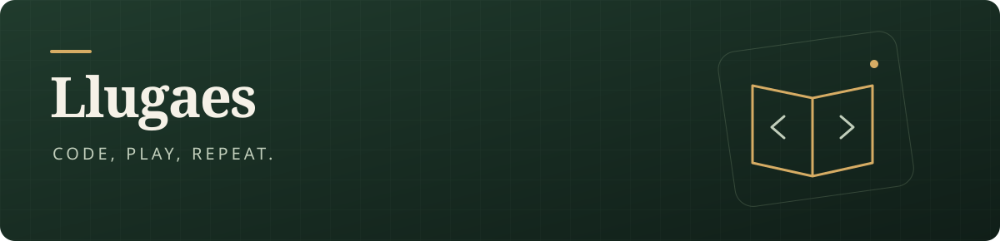

  

写点工具，玩点游戏，留下一些记录。

这里放着我的个人项目：让游戏多一点玩法，也让日常操作少一点重复。

### 正在做的东西

| 项目 | 关于它 |
| :--- | :--- |
| **[游记 · Game Journal](https://llugaes.github.io/game-journal/)** | 玩过的游戏、认真写下的评测，以及截图里的那些瞬间。[源码 ↗](https://github.com/Llugaes/game-journal) |
| **[空之轨迹 the 2nd · 双语 Mod](https://github.com/Llugaes/bilingual-sora-2nd)** | 双语字幕、文本与小字注解，边玩边读另一种语言。 |
| **[Trigger Trim](https://github.com/Llugaes/gamepad-trigger-trim)** | 手柄扳机检测与行程映射预览，让输入参数看得见、调得清。 |

### 游戏之外

也折腾 AI 工具和自动化，把反复做的事情变成顺手的流程。

[逛逛我的游记 →](https://llugaes.github.io/game-journal/) · [看看其他项目 →](https://github.com/Llugaes?tab=repositories)
