  

代码不一定自己写，游戏一定是自己打。

[全部游戏记录](./docs/ACTIVITY.md) · [游记与评测](https://llugaes.github.io/game-journal/)

### 正在做的东西

| 项目 | 关于它 |
| :--- | :--- |
| **[游记 · Game Journal](https://llugaes.github.io/game-journal/)** | 玩过的游戏、认真写下的评测，以及截图里的那些瞬间。[源码 ↗](https://github.com/Llugaes/game-journal) |
| **[空之轨迹 the 2nd · 双语 Mod](https://github.com/Llugaes/bilingual-sora-2nd)** | 双语字幕、文本与小字注解，边玩边读另一种语言。 |

[其他项目 →](https://github.com/Llugaes?tab=repositories)
