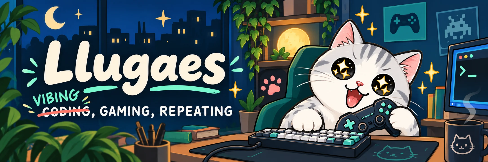

  

代码不一定自己写，游戏一定得自己打！ 
~~游戏时长能不能也算工龄...~~

<a href="./docs/ACTIVITY.md">
  <picture>
    <source media="(max-width: 600px)" srcset="https://raw.githubusercontent.com/Llugaes/Llugaes/40f6b810ba9ca28666ec30b1d31d454f6eb88662/assets/player-log-mobile.webp" />
    
  </picture>
</a>

[游戏游记](https://llugaes.github.io/game-journal/)　/　[空轨双语 Mod](https://github.com/Llugaes/bilingual-sora-2nd)　/　[其他项目](https://github.com/Llugaes?tab=repositories)
